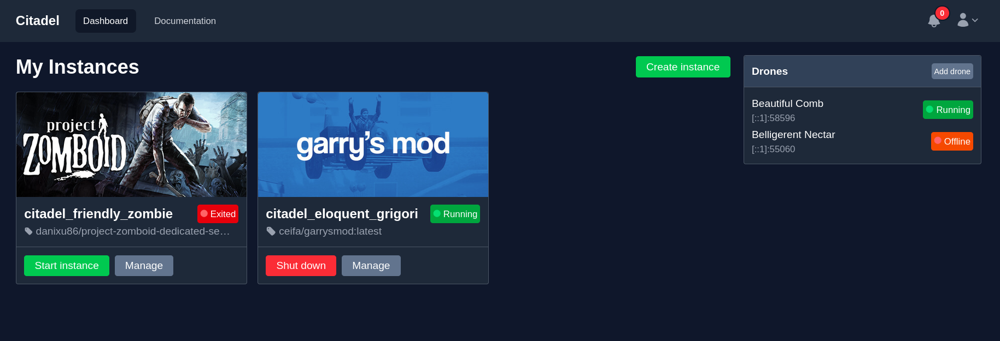
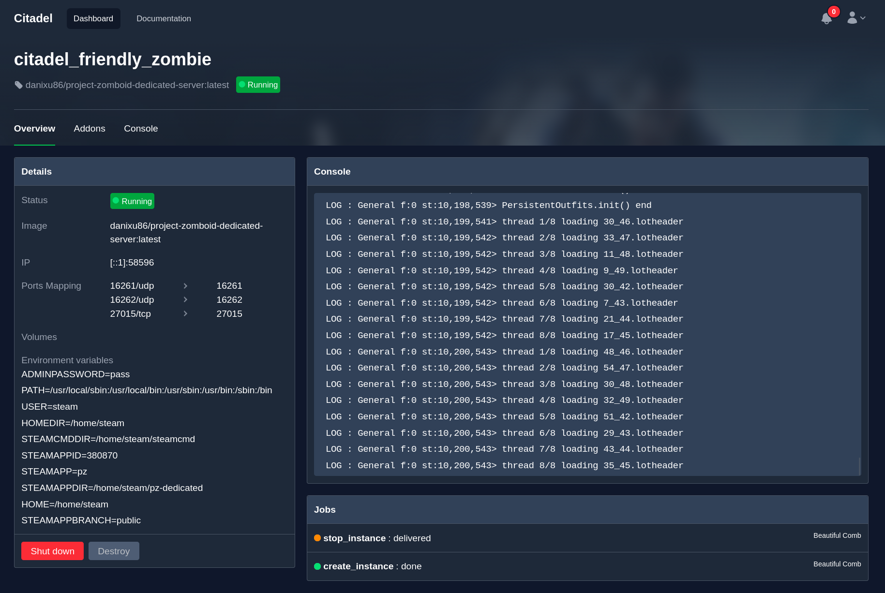
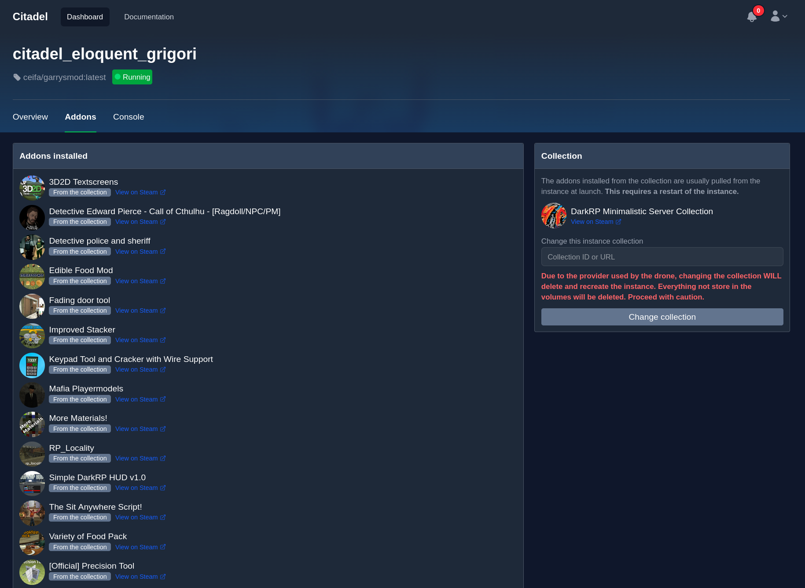

# Citadel

> Code Source can be found on my own git [gitea.strides.fr](https://gitea.strides.fr/TakaashiKun/Citadel).

> :warning: Warning: :construction: This tool is still in active development and doesn't have a stable version, feel free to try it and make feedback/contribute :construction:

Citadel is an open source tool and UI to create game servers on the fly, it's currently mainly based on Docker and containers but has a providers system which should allow to add more backends.

You can see this tool as an orchestrator for game servers. Citadel is composed of a main ReST API and UI (the Hive) and multiple others agents (Drones) which launch the game instances.

Citadel aims to implement game specific addons management.

## Terminology

- Hive: The hearth of Citadel, the main server which registers the Drones
- Drone: The agents of Citadel, they launch the containers / instances of the game servers
- Instance: A game server created in Citadel

## Games supported

| Game            |     Supported      |
| --------------- | :----------------: |
| Garry's Mod     | :heavy_check_mark: |
| Project Zomboid | :heavy_check_mark: |

## Dashboard

The dashboard allows to create game instances with a simple UI

_The Dashboard:_

_The Instance overview page:_

_The Instance addons management:_


## Getting started

**The software uses Go 1.25.5, Rust 1.92 and NPM 11 for web_src scripts**

1. Pull the repository
2. Run `npm install` to install dependencies
3. Run `docker compose up -d` to run the mongo and a redis databases or run your own
4. Be sure to have these environment variables:

```bash
CITADEL_HIVE_TOKEN=01H7G0A9JK6P5430N8PBTEJ9PH
CITADEL_HIVE_HOST=http://localhost:3000
MONGO_URL=mongodb://localhost:27017/
PASSWORD_SALT="YOUR SALT"
JWT_SECRET="YOUR SECRET"
```

5. Run `npm run build:js; npm run build:css` to build the web_src components (small tailwind and react components)
6. In 2 differents consoles, run:
   - `go run .`
   - `cd citadel-drone; cargo run`
7. You can open the Citadel UI in your browser with [http://localhost:3000](http://localhost:3000) and create an account.

## Contributing

There is still no contribution guide or issue template.
At the moment, my own git server is not open for contributions, please do not hesitate to reach me if you are interested by the project.
